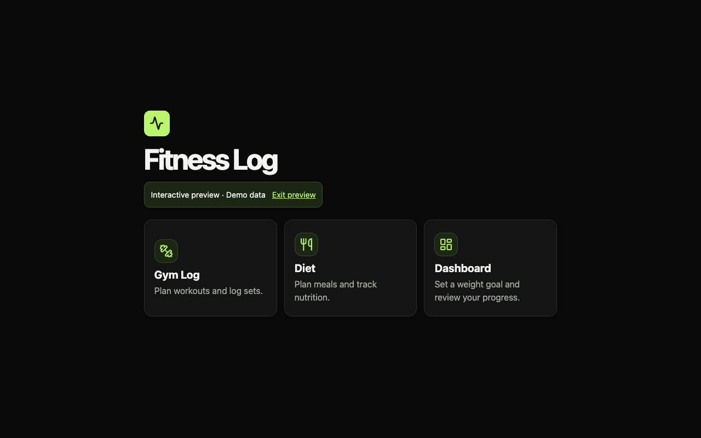
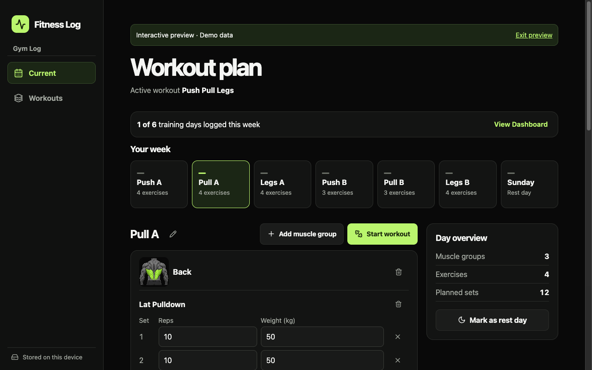
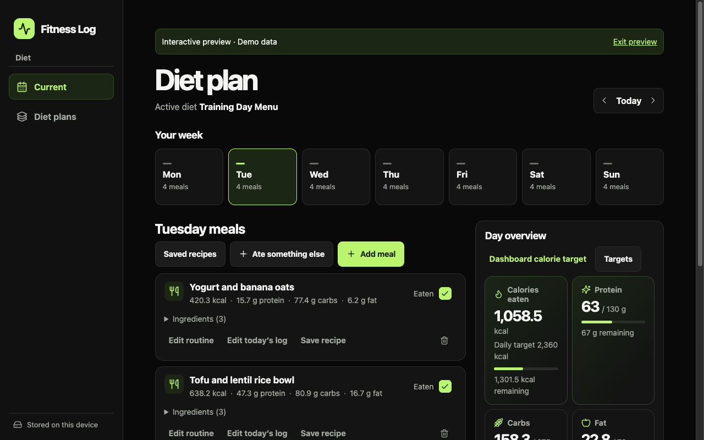
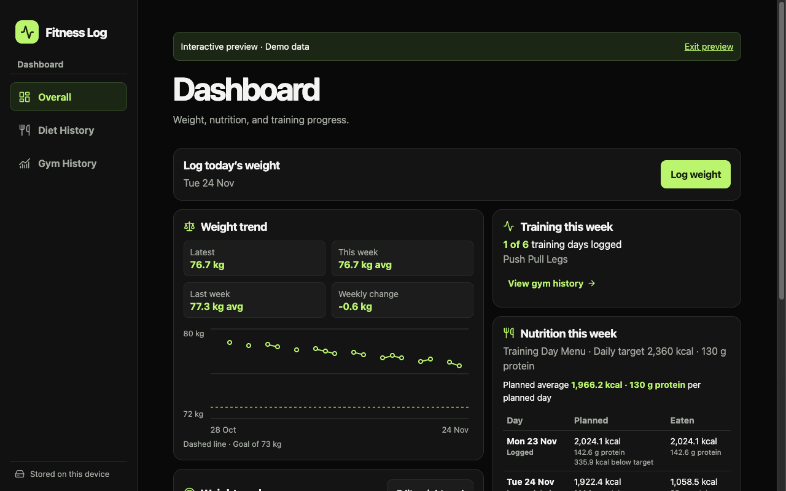

# Fitness Log

Fitness Log is a black-and-green workout and meal tracker for Mac and iPhone browsers. **Gym Log** contains workout plans and set logging. **Diet** contains meal planning, nutrition targets, and intake tracking. **Dashboard** brings together Cut, Bulk, and Maintain goals, daily weigh-ins, and both histories.

## Screenshots

| Home | Gym Log |
| --- | --- |
|  |  |
| **Diet** | **Dashboard** |
|  |  |

## Run on your Mac

Install Node.js 22.12 or newer. In Terminal, run:

```sh
git clone https://github.com/crazyguy96/fitness-log.git
cd fitness-log
npm ci
npm run build
npm start
```

Open [Fitness Log on this Mac](http://localhost:4173). Keep Terminal running while you use the app. Press Control+C to stop it.

## Open on your iPhone

1. Connect your iPhone and Mac to the same Wi-Fi network. Keep the Mac awake and the server running.
2. In Terminal, look for the **Network** address printed by `npm start`, such as `http://192.168.1.23:4173`.
3. Open that exact address in Safari on the iPhone. If macOS prompts to allow incoming connections on your trusted network, allow them for the server.

Use the same address on each device when returning to your plan. The app saves gym and diet data in the browser for that address. The Mac and iPhone have separate data, and changing the address or clearing browser website data can affect access to prior entries. No credentials or environment variables are required.

## Open the interactive preview

With the server running, open [the Fitness Log demo](http://localhost:4173/?preview=1). On iPhone, add `?preview=1` to the network address. The preview has two workout and two diet plans, scheduled days, and sample history. Try logging sets, ticking meals, or editing plans. Demo changes are saved separately in the same browser. **Exit preview** returns to your own data.

## Try the workout flow

In **Current**, the app opens on today’s weekday. Add **Chest**, then search for “press” and pick **Bench Press**. Add sets and fill in their reps and weights. Start the workout, tick the sets you finish, and save it. Use the week selector to edit other templates. Open **Dashboard → Gym History** to review the set details and charts. Log another workout with the same exercise to see both sessions in the charts.

To schedule rest, select a day and choose **Mark as rest day**. **Switch to workout day** brings back your plan. During a workout, each set can be ticked or unticked independently, and the draft saves your ticks as you go.

To enter an exercise of your own, open **Add exercise** under the muscle group and choose **Add custom exercise → Save and add**. Your name is saved in that muscle group's library. To mark completed sets, choose **Start workout** and tick the boxes in the **Done** column beside the reps and weight.

In **Workouts**, choose **Add workout** to create another seven-day plan, then **Use workout** to open it in Current. Each plan keeps its own in-progress session. In **Dashboard → Gym History**, expand a session to see completed and unchecked sets, or filter by workout plan. Progress charts are based on completed sets.

## Try the diet flow

Choose **Diet** on the Fitness Log home screen. In **Current → Add meal → New meal**, enter “two whole wheat breads and 120 mL yogurt.” Choose **Check ingredients** to review slices, millilitres, the reference weights, and the totals. Supply any missing amounts or conversions, then save the meal and tick it when eaten. **Nutrition targets** supports a protein preset and manual nutrition targets. [ICMR–NIN data](https://www.nin.res.in/ebooks/IFCT2017.pdf) · [USDA serving data](https://fdc.nal.usda.gov/download-datasets/) · [FDA volume equivalents](https://www.fda.gov/regulatory-information/search-fda-guidance-documents/guidance-industry-guidelines-determining-metric-equivalents-household-measures) · [Mifflin–St Jeor equation](https://pubmed.ncbi.nlm.nih.gov/2305711/)

In **Diet plans**, create a plan, set its calorie and macro **Targets**, and choose **Use plan**. In **Current**, choose a weekday and use **Add meal** to pick from that plan’s saved meals. Add reusable meals from **Diet plans → Meal library**, or choose **New meal** in Current to add it to both the weekday and the library. Tick each meal as you eat it. **What to eat next** shows the unchecked meals for the selected date. **Dashboard → Diet History** shows routine adherence, intake averages, and daily meal records by plan.

Today’s meals can be marked eaten or corrected in Current. Use **Edit routine** to update the weekday template and **Edit today’s log** to correct an eaten entry. Other dates keep their completion status and logged nutrition read-only.

## Try the Dashboard

Open **Dashboard → Overall**, log a weigh-in, and set a weight goal. Choose **Cut**, **Bulk**, or **Maintain** to calculate and review a daily calorie target. Save the goal to apply it to the active diet. The Dashboard follows the active workout and diet plans and compares their weekly schedule with your logged activity. Use **Diet History** and **Gym History** to see the detailed records and charts.

Open [Dashboard with sample data](http://localhost:4173/?preview=1#dashboard) to try the flow with weigh-ins already in the weight chart.

For development, run `npm run dev`. The production build command checks TypeScript before generating `dist/`.

## Exercise library references

The built-in library includes movements discussed in these Jeff Nippard videos, plus other common gym, band, and bodyweight variations. Exercise suggestions match the selected muscle group and the search text.

- Upper body. [Chest](https://www.youtube.com/watch?v=fGm-ef-4PVk), [Back](https://www.youtube.com/watch?v=jLvqKgW-_G8), [Shoulders](https://www.youtube.com/watch?v=SgyUoY0IZ7A), [Biceps](https://www.youtube.com/watch?v=GNO4OtYoCYk), [Triceps](https://www.youtube.com/watch?v=OpRMRhr0Ycc), [Forearms](https://www.youtube.com/watch?v=qOe5uDVSqnE), [Traps](https://www.youtube.com/watch?v=C6sYjDFuq9I).
- Lower body and core. [Quadriceps](https://www.youtube.com/watch?v=kIXcoivzGf8), [Romanian deadlifts](https://www.youtube.com/watch?v=_oyxCn2iSjU), [Glutes](https://www.youtube.com/watch?v=3ryh7PNhz3E), [Calves](https://www.youtube.com/watch?v=21inrjhoFkQ), [Abs](https://www.youtube.com/watch?v=Tn-XvYG9x7w).

## Source credits

- **Nutrition data**:
  - Indian recipe estimates use nutrient data from Anuvaad Solutions and University of Edinburgh. See the publisher for the dataset and reuse terms. [Indian Nutrient Databank](https://www.anuvaad.org.in/indian-nutrient-databank/)
  - [Katori Indian food nutrition dataset](https://getkatori.com/data) — used for Indian dish portion estimates and nutrient totals under [CC BY 4.0](https://creativecommons.org/licenses/by/4.0/).
  - [ICMR–NIN Indian Food Composition Tables (IFCT 2017)](https://www.nin.res.in/ebooks/IFCT2017.pdf) — National Institute of Nutrition, Indian Council of Medical Research.
  - [USDA FoodData Central](https://fdc.nal.usda.gov/data-documentation/) — reference serving and macronutrient profiles.
  - [FDA volume equivalents](https://www.fda.gov/regulatory-information/search-fda-guidance-documents/guidance-industry-guidelines-determining-metric-equivalents-household-measures) for household measures.
  - [Mifflin–St Jeor equation](https://pubmed.ncbi.nlm.nih.gov/2305711/) for BMR and energy requirements.
  - [Sports nutrition position statement](https://www.dietitians.ca/DietitiansOfCanada/media/Documents/Resources/noap-position-paper.pdf) for daily protein multiplier presets.
- **Anatomy & illustrations**:
  - The project uses stylized workout artwork and a supplied rear-view triceps image. OpenStax Anatomy and Physiology 2e is an anatomy reference. OpenStax lists its textbook license as CC BY-NC-SA 4.0. [OpenStax preface](https://openstax.org/books/anatomy-and-physiology-2e/pages/preface)
- **Exercise library**:
  - Built-in exercise library movements and form references based on the Jeff Nippard videos linked above.
